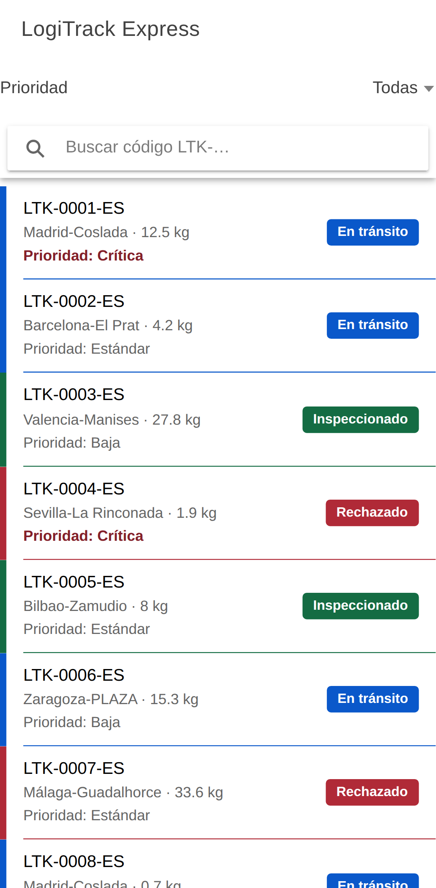
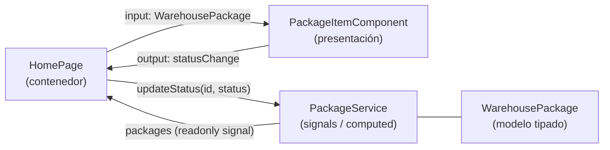

<div align="center">

# LogiTrack Express

**Interfaz híbrida, reactiva y accesible para la recepción, inspección y clasificación de paquetes.**

Desarrollo de Interfaces (0488) · 2.º DAM · Instituto Nebrija · 2026/2027

<br>

[](https://github.com/FabioRieker/Actividad-2-Individual/actions/workflows/ci.yml)


</div>

---

## Índice

- [Vista previa](#vista-previa)
- [Características clave](#características-clave)
- [Stack tecnológico](#stack-tecnológico)
- [Arquitectura](#arquitectura)
- [Tareas de la actividad](#tareas-de-la-actividad)
- [Puesta en marcha](#puesta-en-marcha)
- [Calidad](#calidad)
- [Accesibilidad](#accesibilidad)
- [Despliegue](#despliegue)
- [Evidencias](#evidencias)
- [Flujo de ramas y commits](#flujo-de-ramas-y-commits)
- [Autor y licencia](#autor-y-licencia)

---

## Vista previa

<p align="center">
  
</p>

<p align="center"><sub>Captura en emulación móvil con paquetes en distintos estados. Se incorporará con la Tarea 2.</sub></p>

## Características clave

- 📦 **Recepción y clasificación** de paquetes con código de seguimiento `LTK-XXXX-ES`, hub de destino, peso, prioridad y estado.
- 🔎 **Búsqueda y filtrado en tiempo real** por código de seguimiento y por prioridad.
- ✅ **Acciones rápidas** por paquete para marcarlo como inspeccionado o rechazado.
- ⚡ **Estado reactivo** con Signals y valores derivados con `computed()`.
- 🧩 **Componentes standalone** sin `NgModule` y control de flujo moderno (`@for`, `@if`, `@empty`).
- ♿ **Accesibilidad** orientada a WCAG 2.1 AA para entornos de baja luminosidad.

## Stack tecnológico

| Capa | Tecnología | Versión |
| --- | --- | --- |
| Framework | Angular (standalone) | 21.2 |
| UI híbrida | Ionic Framework | 8.8.21 |
| Nativo | Capacitor | 8.6 |
| Lenguaje | TypeScript (`strict`, `strictTemplates`) | ~5.9 |
| Reactividad | Signals / `computed()` y RxJS | RxJS ~7.8 |
| Runtime | Node.js | 24.21.0 |
| Pruebas unitarias | Vitest + jsdom | 4.x |
| Pruebas E2E | Playwright | 1.64 |
| Calidad | ESLint, Prettier, commitlint, Husky | — |
| CI | GitHub Actions | — |

## Arquitectura

Arquitectura desacoplada basada en componentes (Component-Driven Architecture): la página contenedora gestiona el estado, el componente hijo solo recibe datos y emite eventos, y el servicio es la única fuente de verdad.



> `PackageItemComponent` y el filtrado con `computed()` se incorporan en las Tareas 2, 3 y 5; hoy existen el modelo, el servicio y la página base.

<details>
<summary><strong>Estructura de carpetas relevante</strong></summary>

```text
.
├── .github/workflows/ci.yml     # Integración continua
├── e2e/                         # Pruebas E2E (Playwright)
├── evidence/                    # Evidencias por tarea
│   └── tarea1/
├── scripts/capture.mjs          # Captura automatizada de evidencias
├── src/
│   ├── app/
│   │   ├── home/                # Página contenedora (HomePage)
│   │   ├── models/
│   │   │   └── package.model.ts # Interfaz WarehousePackage
│   │   └── services/
│   │       └── package.service.ts # Estado con Signals y datos mock
│   ├── environments/
│   └── theme/variables.scss
├── angular.json
├── commitlint.config.mjs
├── eslint.config.js
├── playwright.config.ts
└── vitest.config.mts
```

</details>

## Tareas de la actividad

| Tarea | RA / CE | Qué se entrega | Estado |
| --- | --- | --- | --- |
| **T1** Andamiaje | RA1 · CE 1.c, 1.d | Proyecto Ionic standalone, modelo `WarehousePackage` y `PackageService` con datos mock tipados en `strict` | ✅ Completada |
| **T2** Vista declarativa | RA2 · CE 2.b, 2.c | Layout con `ion-header`, `ion-searchbar` e `ion-list` con `ion-item-sliding`; `@for`/`@if`/`@empty` y data binding | 🚧 En desarrollo |
| **T3** Componente reutilizable | RA3 · CE 3.b, 3.c | Componente standalone con entrada tipada, salida `statusChange` y botones de acción rápida | 🚧 En desarrollo |
| **T4** Accesibilidad WCAG 2.1 AA | RA4 · CE 4.a, 4.b, 4.c | Auditoría Lighthouse, tabla de incumplimientos y correcciones | 🚧 En desarrollo |
| **T5** Validación crítica de código generado | RA1 y RA3 (transversal) | Auditoría de un filtrado reactivo con RxJS generado por un asistente externo (fugas de memoria, tipado, alternativa con Signals) y refactorización integrada | 🚧 En desarrollo |

> Esta tabla se actualizará a medida que se integre cada tarea.

## Puesta en marcha

**Requisitos:** [nvm](https://github.com/nvm-sh/nvm) y Node.js 24.21.0 (fijado en `.nvmrc` y en `engines`).

```bash
nvm use          # selecciona Node 24.21.0
npm ci           # instalación reproducible
npm start        # servidor de desarrollo en http://localhost:4200
```

También puede usarse `ionic serve` si se dispone de Ionic CLI.

| Script | Comando | Descripción |
| --- | --- | --- |
| `start` | `ng serve` | Servidor de desarrollo |
| `build` | `ng build` | Compilación de producción |
| `typecheck` | `tsc --noEmit` (app y spec) | Comprobación de tipos |
| `lint` | ESLint + typecheck E2E + Prettier | Análisis estático y formato |
| `lint:fix` | ESLint y Prettier con corrección | Corrige lo corregible |
| `test` | `ng test --no-watch` | Pruebas unitarias (Vitest) |
| `test:unit:watch` | `ng test --watch` | Pruebas unitarias en modo observación |
| `test:e2e` | `playwright test` | Pruebas de extremo a extremo |
| `capture` | `node scripts/capture.mjs` | Captura de pantalla para evidencias |

## Calidad

- **TypeScript estricto:** `strict: true` y `strictTemplates`, sin `any`.
- **ESLint sin avisos:** `ng lint --max-warnings 0`.
- **Conventional Commits** validados con commitlint en el hook `commit-msg` de Husky.
- **Integración continua** en GitHub Actions (`.github/workflows/ci.yml`) sobre `develop` y `main`: instalación con `npm ci`, lint, comprobación de tipos, build y pruebas unitarias.

## Accesibilidad

Compromiso de cumplir **WCAG 2.1 nivel AA**:

- `aria-label` obligatorio en botones que solo contienen icono (criterio 4.1.2).
- Insignias de estado y prioridad con **texto y color**, nunca solo color (1.4.1).
- Contraste suficiente de texto e iconos (1.4.3).
- Foco de teclado visible y gestionado (2.4.7).

| Auditoría | Resultado |
| --- | --- |
| Lighthouse, Accesibilidad (inicial) | Pendiente de la Tarea 4 |
| Lighthouse, Accesibilidad (final) | Pendiente de la Tarea 4 |

## Despliegue

Planificado, aún no realizado:

- **Docker** para empaquetar y ejecutar la aplicación en local.
- **Vercel** para el alojamiento de la versión web.
- **Supabase** como posible backend de datos.

No hay URLs de producción activas todavía.

## Evidencias

La carpeta [`evidence/`](evidence/) agrupa los artefactos de cada tarea, uno por subcarpeta:

| Carpeta | Contenido |
| --- | --- |
| [`evidence/tarea1/`](evidence/tarea1/) | Registros de creación del proyecto, fijado de versiones, `tsc`, `lint`, `build` y pruebas, y captura de la aplicación en ejecución (`ionic-serve.png`) |
| `evidence/tarea2/` | Capturas en emulación móvil y consola sin avisos *(llegará con la Tarea 2)* |
| `evidence/tarea3/` | Capturas antes y después de una acción de estado *(llegará con la Tarea 3)* |
| `evidence/tarea4/` | Informes Lighthouse inicial y final *(llegará con la Tarea 4)* |
| `evidence/tarea5/` | Prompt, respuesta literal y análisis crítico *(llegará con la Tarea 5)* |

<details>
<summary><strong>Regenerar capturas</strong></summary>

`npm run capture` levanta el servidor de desarrollo con Playwright y guarda la captura en `evidence/`. Con la variable `CAPTURE_URL` puede apuntarse a un servidor ya en marcha.

</details>

## Flujo de ramas y commits

| Rama | Propósito |
| --- | --- |
| `main` | Versión estable y entregable |
| `develop` | Integración; recibe cada tarea terminada |
| `tarea-n-slug` | Una rama por tarea (por ejemplo `tarea-1-andamiaje`) |

Cada tarea se desarrolla en su rama y se integra en `develop`. Los mensajes siguen [Conventional Commits](https://www.conventionalcommits.org/es/v1.0.0/) en español, con cabecera de máximo 72 caracteres y sin punto final:

```text
feat(servicio): añadir actualización de estado del paquete
docs(evidencia): añadir evidencias de la tarea 1
```

## Autor y licencia

**Fabio Rieker** · 2.º DAM · Instituto Nebrija

Proyecto académico — uso educativo.
